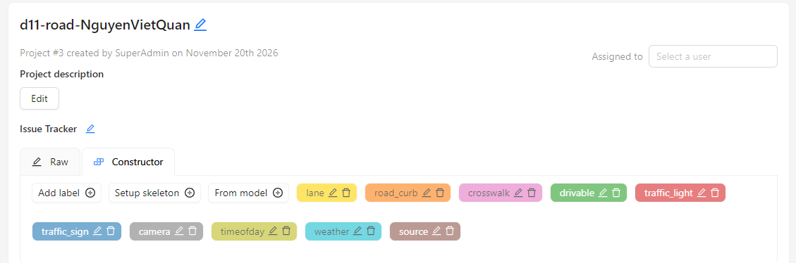
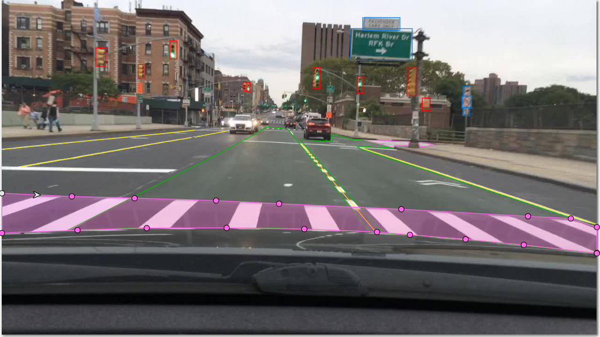
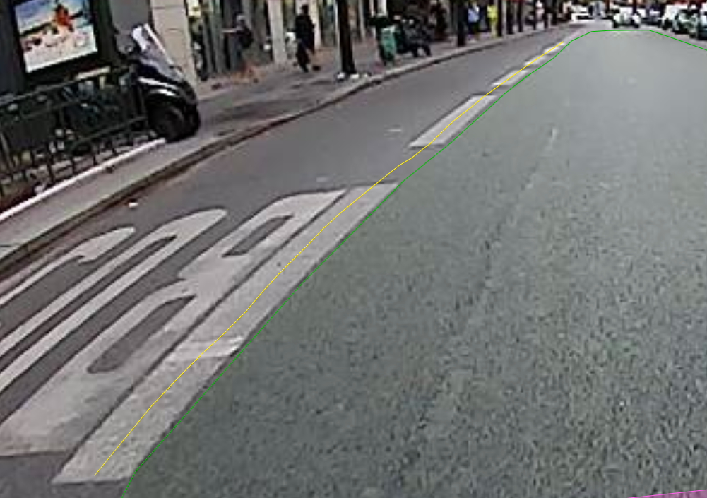
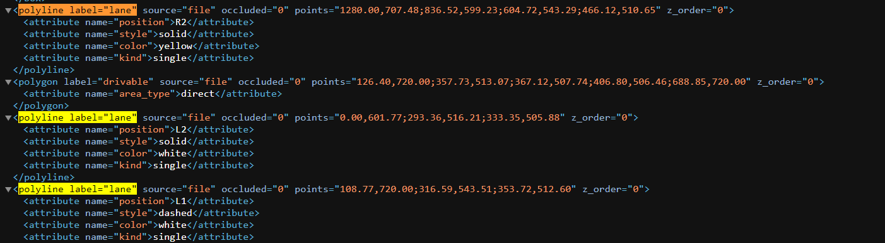

# Báo cáo cá nhân — Ngày 11

Họ tên: Nguyễn Việt Quân
Mã học viên: 2A202603035  
Phiên bản CVAT (Help → About): 2.74.1  
Guideline: Road v1.0  
Lần nộp (`revision` trong manifest): 3  
Thời điểm export (ngày giờ trên CVAT): 22nd 26, 11:16
Số lần nộp lại sau Rework: 2

## 1. Kiểm project

| Mục | Đúng như guideline Road v1.0? | Ghi chú |
| --- | --- | --- |
| 6 label, đúng kiểu | Có trong XML export | lane/polyline, road_curb/polyline, crosswalk/polygon, drivable/polygon, traffic_light/rectangle, traffic_sign/rectangle |
| Thuộc tính và giá trị | Có trong XML export | Định nghĩa label khớp taxonomy Road v1.0; lint không báo label hoặc giá trị lạ |
| 4 tag ảnh | Có | camera, timeofday, weather, source; mỗi tag có thuộc tính `value`; 28/28 ảnh đủ tag theo manifest revision 3 |

Cách kết thúc polyline trên bản CVAT này: nhấn n để kết thúc vẽ polyline 
Cách đặt tag ảnh trên bản CVAT này: đặt camera, timeofday, weather, source và kiểm tra giá trị trong Details.

## 2. Số lượng đã gán

Số liệu được đếm từ hai ZIP revision 3; chỉ tính shape, không tính tag.

| Task | Ảnh | lane | road_curb | crosswalk | drivable | traffic_light | traffic_sign |
| --- | ---: | ---: | ---: | ---: | ---: | ---: | ---: |
| front | 12 | 34 | 4 | 8 | 26 | 25 | 24 |
| front-extra (đã làm 4 / 4) | 4 | 12 | 2 | 5 | 10 | 10 | 15 |
| fisheye | 8 | 10 | 8 | 9 | 6 | 5 | 1 |
| fisheye-extra (đã làm 4 / 4) | 4 | 4 | 4 | 3 | 2 | 0 | 0 |

## 3. Bảng ca khó

Các ca dưới đây lấy từ lint và phản hồi QC chéo; bổ sung thêm các ca bạn thực sự phân vân khi gán.

| Ảnh | Nhãn | Phân vân giữa | Đã chọn | Lý do |
| --- | --- | --- | --- | --- |
| A05 | lane | Không thấy vạch L1/R1 hay bị sót nhãn | Không có L1/R1 trong revision 3 | Lint vẫn báo thiếu cả L1/R1; cần coach xác nhận nếu thực sự không thấy vạch |
| A06 | lane | R1 không thấy hay bị sót | Đã thêm R1 ở góc phải dưới trong revision 3 | Đã xử lý góp ý QC1-02 của An; lint không còn cảnh báo thiếu L1/R1 ở A06 |
| A04 | lane | Cách biểu diễn hai nét song song/vạch đôi | Export có nhiều polyline cùng position | Chờ coach xác nhận quy ước hình học; An chưa tính là lỗi |
| A07 | lane | Không thấy vạch L1 hay bị sót nhãn | Không có L1 trong revision 3 | Lint vẫn cảnh báo; cần kiểm ảnh/coach xác nhận |
| A09 | lane | R1 không thấy hay bị thiếu; hai polyline cùng L2 | Không có R1, có hai polyline L2 trong revision 3 | Lint vẫn cảnh báo; cần xác nhận vạch R1 có nhìn thấy và cách biểu diễn L2 |
| A14 | lane | Không thấy R1 hay bị sót nhãn | Không có R1 trong revision 3 | Lint vẫn cảnh báo; cần kiểm ảnh/coach xác nhận |
| A10 | drivable | `direct` có cần kéo qua phía sau xe trước không | Hình học không đổi so với revision 2 | QC An yêu cầu kéo tiếp qua phía sau xe; đây vẫn là mục chưa sửa |
| B02 | traffic_light | `edge_zone` có đúng ở các đèn sát mép không | Hai box mới vẫn có `edge_zone=false` | Lint revision 3 gợi ý bật `edge_zone` cho hai box; cần tự kiểm tra |

## 4. Phiếu QC 1 nhận được

Bạn kiểm lô của tôi: Nguyễn Thị Thúy An 
Quyết định nhận được cho revision 2: **Rework** — An kiểm 6 ảnh (A03, A04, A06, A10, B02, B04), tổng 80 mục (56 shape + 24 tag). Ghi nhận 1 lỗi nặng và 13 lỗi chính / 80 = 16,3%, cao hơn ngưỡng 5%. An ghi rằng kết luận vẫn là Rework nếu coach miễn QC1-02 ở A06. Các mục dưới đây được đối chiếu lại với ZIP revision 3; revision 3 chưa có phiếu QC độc lập.

| Mã lỗi | Số lỗi | Đồng ý? | Đã sửa? |
| --- | ---: | --- | --- |
| QC1-02 đủ L1/R1 | 1 | Đã đối chiếu: A06 có R1 ở revision 3 | Đã sửa; vẫn cần coach xác nhận nếu có miễn trừ |
| QC1-06 style/color/kind | 1 | A04 R1 đổi từ `solid` sang `dashed` | Đã sửa |
| QC1-07 vùng lái | 1 | A10 `direct` không đổi, vẫn dừng gần y=445 thay vì tiếp tục qua phía sau xe trước | Chưa sửa |
| QC1-08 đèn | 6 | Đã thêm đèn A03 và bốn đèn B02; đã bỏ box trùng A10. Hai gợi ý `edge_zone` của lint được ghi riêng bên dưới, không thuộc sáu lỗi QC1-08 của An | Đã sửa |
| QC1-09 thuộc tính đèn/biển | 2 | Biển trường học A03 đổi thành `warning`; One Way A06 đổi thành `mandatory` | Đã sửa |
| QC1-10 đủ biển | 3 | Đã thêm ba biển cấm ở A10, nhóm `prohibitory` | Đã sửa |

Các ca chờ coach/lead: quy tắc hình học vạch đôi A04; miễn R1 A06 (nếu có); điểm đầu lane R1 A03 có được kéo qua đoạn không thấy sơn; nhóm biển quay lưng A03; cách hiểu `dusk` ở A03/A04/A06; nhãn ngoài trọng tâm task ở B02. Phiếu An ghi vùng `direct` chồng crosswalk ở B02/B04 là hợp lệ, không tính lỗi.

## 5. Kiểm file export

Các ZIP mở được bằng checker; manifest revision 3 ghi `contains_images=false` và SHA-256 khớp hai file revision 3.

| File | Mở lại được? | Số shape ảnh 1 (job / file) | Số shape ảnh 2 (job / file) | Tag camera có trong XML? |
| --- | --- | ---: | ---: | --- |
| `nguyenvietquan-front.zip` | Có | A01: 8 | A02: 6 | Có (`front`) |
| `nguyenvietquan-fisheye.zip` | Có | B01: 4 | B02: 10 | Có (`fisheye_front`) |

Manifest revision 3 ghi 28 ảnh, đủ tag trên 28/28 ảnh, không kèm ảnh; hai ZIP mở lại được. Tổng số shape: front 175, fisheye 52 (227 shape). Đã lưu ZIP và manifest revision 2 trong `r2/`; manifest cũ được đổi tên thành `nguyenvietquan-manifest-r2.json`.

`road_check lint` trên revision 3 báo **5 cảnh báo nặng, 8 chính, 1 nhẹ**. Các cảnh báo nặng còn ở A05 (L1/R1), A07 (L1), A09 (R1), A14 (R1); các mục chính gồm polyline cùng position ở A04, A08, A09, A11, A14 và hai gợi ý `edge_zone` ở B02; cảnh báo nhẹ là một điểm lặp ở crosswalk A14. Lint chỉ là gợi ý, không thay thế kiểm tra trực quan hoặc đối chiếu GT.

## 6. Ảnh chụp màn hình

Đã có đủ bốn ảnh chụp được đặt trong thư mục bàn giao:

1. Tab Labels của project.

2. Một ảnh camera trước đã gán đủ (làn, vùng lái, đèn/biển).

3. Một ảnh fisheye đã gán, phóng to đoạn polyline cong.

4. Một đoạn XML có `<polyline label="lane">`.

## 7. Tự đánh giá

QC chéo revision 2 ghi nhiều lỗi nhất ở QC1-08 (6 lỗi đèn), kế đến QC1-10 (3 biển bị bỏ sót). Trong revision 3, các biển/đèn được chỉ ra đã được bổ sung hoặc sửa phần lớn, nhưng vùng `direct` A10 vẫn chưa kéo dài và hai đèn B02 còn cần kiểm `edge_zone`. Bỏ sót đèn/biển làm dữ liệu huấn luyện thiếu ví dụ về các đối tượng thật sự có trong cảnh; box đèn trùng có thể dạy model dự đoán hai nhãn cho cùng một cụm.  
**Trạng thái revision 3:** đã đối chiếu lại theo phiếu An và lint, nhưng chưa được QC chéo độc lập hoặc đối chiếu GT. Còn việc cần xử lý/xác nhận: A10 `direct`, hai thuộc tính `edge_zone` ở B02, các cảnh báo lane A05/A07/A09/A14 và các ca chờ lead. Để tránh lặp ở Ngày 20, dùng checklist từng ảnh để rà đủ đèn/biển nhìn thấy, loại box trùng và xác nhận L1/R1 trước khi Finish/export.

## 8. (Tùy chọn, buffer) Từ polyline đến đích row-anchor

Chưa có số liệu row-anchor; để trống nếu không làm hoạt động buffer.

| y | 720 | 680 | 640 | 600 | 560 |
| --- | ---: | ---: | ---: | ---: | ---: |
| x của chúng tôi |  |  |  |  |  |
| x của bạn kia |  |  |  |  |  |

1.  Nếu dừng polyline sớm 40 px, hàng nào đổi thành “không có làn”?
2.  So với bạn được kiểm, ở hàng 720 và 560 hai bạn lệch bao nhiêu pixel? Lệch hàng nào ảnh hưởng LKA nhiều hơn?
3.  Nếu polyline vẽ từ xa về gần, cách tính có đổi không? Script nào sẽ gặp khó?
